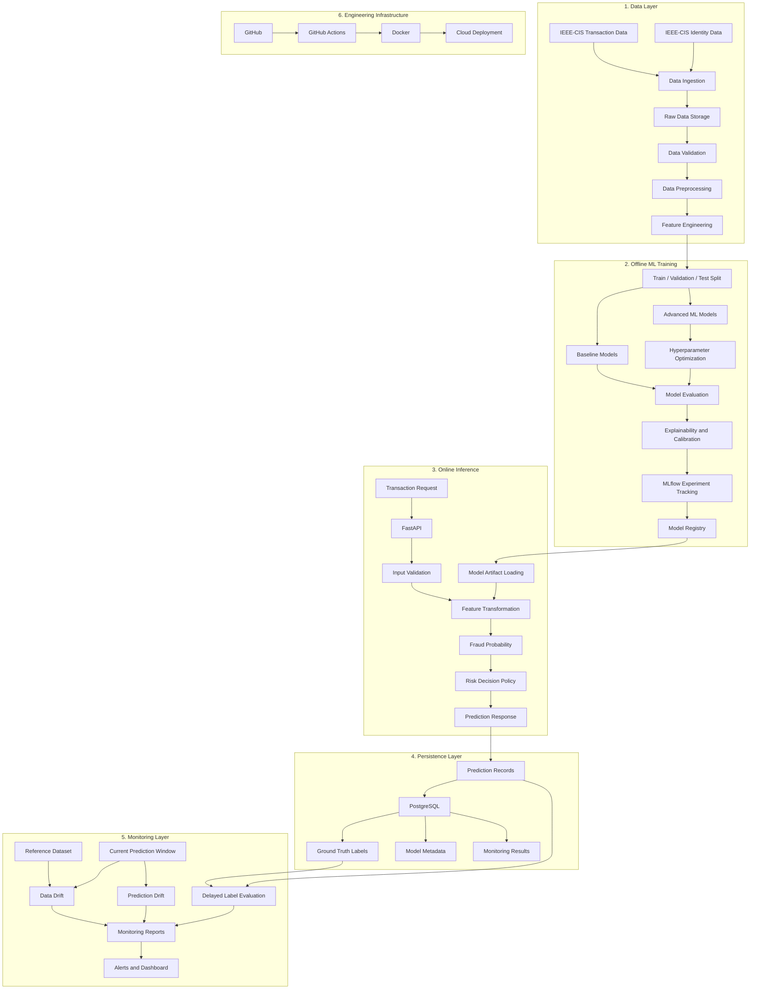
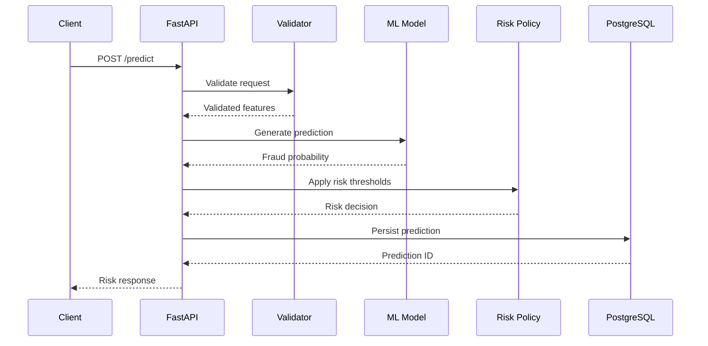

# System Architecture Document

## Real-Time Card Fraud Scoring Platform with Drift Monitoring

**Project:** Card Fraud Scoring Platform  
**Document:** System Architecture and Technical Design  
**Version:** 1.0  
**Architecture Style:** Modular ML application with separate offline training and online inference pipelines  
**Primary Language:** Python

---

# 1. Architecture Overview

## 1.1 Purpose

This document describes the architecture, components, data flows, technology choices, and operational responsibilities of the Card Fraud Scoring Platform.

The system is designed to demonstrate an end-to-end production-oriented ML workflow.

It separates:

1. Offline data processing and model training.
2. Online transaction inference.
3. Prediction storage and outcome management.
4. Drift and model performance monitoring.
5. Model lifecycle management.

The architecture prioritizes reproducibility, maintainability, testability, observability, and separation of concerns.

## 1.2 High-Level Architecture

The platform consists of the following major components:

- Data ingestion layer.
- Data validation layer.
- Feature engineering layer.
- ML training pipeline.
- Experiment tracking and model registry.
- Model inference service.
- REST API.
- PostgreSQL database.
- Monitoring pipeline.
- Monitoring dashboard.
- CI/CD and deployment infrastructure.

## 1.3 Architecture Diagram



---

# 2. Architecture Design Principles

The system follows these principles.

## 2.1 Separation of Concerns

Each component must have a clearly defined responsibility.

Examples:

- Data ingestion must not contain model training logic.
- Feature engineering must not depend on FastAPI.
- API endpoints must not implement training algorithms.
- Monitoring must not automatically deploy new models.
- Database access must be separated from business logic.

## 2.2 Reproducibility

Training runs must be reproducible using:

- Versioned source code.
- Dataset version information.
- Configuration files.
- Feature definitions.
- Model parameters.
- Experiment metadata.

## 2.3 Consistency Between Training and Serving

The feature transformations used during training must be consistent with those used during inference.

The initial implementation should package fitted preprocessing and prediction logic together wherever possible.

Feature schema versions must be recorded.

## 2.4 Independent Model Lifecycle

Model training and inference must be independent.

The inference service loads an approved model artifact.

Training must not happen during a prediction request.

## 2.5 Observability

The application must expose information about:

- Prediction latency.
- Request failures.
- Prediction volume.
- Model version.
- Data quality.
- Data drift.
- Prediction drift.
- Delayed-label model performance.

---

# 3. Technology Stack

| Layer | Technology | Responsibility |
|---|---|---|
| Programming | Python | Main development language |
| Data processing | Pandas | Data analysis and preprocessing |
| Optional processing | Polars | Efficient columnar transformations |
| Numerical computing | NumPy | Numerical operations |
| ML framework | Scikit-learn | Baseline models and preprocessing |
| Gradient boosting | LightGBM | Advanced tabular classification |
| Explainability | SHAP | Model interpretation |
| Experiment tracking | MLflow | Experiment and artifact tracking |
| Data versioning | DVC | Dataset and pipeline versioning |
| Backend | FastAPI | REST inference service |
| API validation | Pydantic | Request and response validation |
| Database | PostgreSQL | Prediction and monitoring persistence |
| ORM | SQLAlchemy | Database interaction |
| Data validation | Pandera | DataFrame schema validation |
| Monitoring | Evidently | Data and prediction drift analysis |
| Dashboard | Streamlit | Monitoring interface |
| Testing | Pytest | Automated tests |
| HTTP testing | HTTPX | API integration testing |
| Containerization | Docker | Application packaging |
| Orchestration | Docker Compose | Local multi-service execution |
| CI/CD | GitHub Actions | Automated validation and deployment |
| Cloud | AWS or GCP | Application hosting |

Technology choices may evolve as the project develops. New dependencies should be added only when their responsibilities are justified.

---

# 4. Data Architecture

## 4.1 Data Source

The initial dataset is IEEE-CIS Fraud Detection.

Source:

https://www.kaggle.com/competitions/ieee-fraud-detection/data

The training dataset consists of two principal tables:

### Transaction table

`train_transaction.csv`

Contains:

- TransactionID.
- TransactionDT.
- TransactionAmt.
- ProductCD.
- Card-related features.
- Address features.
- Email domain features.
- C-series features.
- D-series features.
- M-series features.
- V-series features.
- isFraud.

### Identity table

`train_identity.csv`

Contains:

- TransactionID.
- DeviceType.
- DeviceInfo.
- id-series features.

The two tables are joined using `TransactionID`.

Not every transaction has identity information.

## 4.2 Data Ingestion

Responsibilities:

1. Read source files.
2. Verify file existence.
3. Validate expected schemas.
4. Check data types.
5. Record dataset metadata.
6. Store raw data in the designated local data directory.

Raw data must remain outside Git.

Suggested directory structure:

```text
data/
│
├── raw/
│   └── ieee_cis/
│       ├── train_transaction.csv
│       ├── train_identity.csv
│       ├── test_transaction.csv
│       └── test_identity.csv
│
├── interim/
│
├── processed/
│
└── reference/
```

## 4.3 Data Validation

Data validation should detect:

- Missing required columns.
- Unexpected column types.
- Duplicate transaction identifiers.
- Invalid numeric values.
- Unexpected target values.
- Unexpected data volume changes.
- Join cardinality problems.
- Missing identity information.

Validation failures must be logged and handled explicitly.

## 4.4 Data Preprocessing

The preprocessing layer is responsible for:

- Missing-value analysis.
- Categorical feature processing.
- Numeric feature handling.
- Duplicate investigation.
- Outlier investigation.
- Feature exclusion.
- Consistent transformations.

All learned preprocessing operations must be fitted using training data only.

## 4.5 Feature Engineering

Feature engineering should be implemented as reusable, testable functions.

Initial feature groups:

- Transaction amount features.
- Time-related features.
- Card-related features.
- Address-related features.
- Device and identity features.
- Historical behavior features where valid.

Important:

The initial dataset does not provide a ready-made live transaction history store.

Features such as transaction velocity must not be fabricated from a single transaction request.

If historical behavior features are introduced, their computation must respect event-time ordering and prevent future-information leakage.

---

# 5. Offline Model Training Architecture

## 5.1 Training Pipeline

The offline training pipeline is responsible for creating and evaluating candidate models.

The pipeline follows these steps:

1. Load processed historical data.
2. Validate data.
3. Construct chronological train, validation and test partitions.
4. Fit preprocessing on training data.
5. Train baseline models.
6. Train advanced models.
7. Perform hyperparameter optimization.
8. Evaluate models.
9. Perform error analysis.
10. Calibrate probabilities where justified.
11. Generate explainability reports.
12. Log experiments.
13. Register approved model artifacts.

## 5.2 Candidate Models

Baseline models:

- Dummy Classifier.
- Logistic Regression.
- Random Forest.

Advanced models:

- LightGBM.
- XGBoost.
- CatBoost.

Model selection must be based on:

- PR-AUC.
- Precision and recall.
- False-positive rate.
- Calibration.
- Inference latency.
- Model complexity.
- Reproducibility.

Accuracy must not be the only selection criterion.

## 5.3 Experiment Tracking

MLflow will store:

- Experiment name.
- Run identifier.
- Parameters.
- Metrics.
- Model artifacts.
- Training configuration.
- Dataset reference.
- Feature schema version.

Each experiment must be traceable to the code and data configuration used to produce it.

## 5.4 Model Registry

The model registry will maintain candidate and approved model versions.

Suggested lifecycle:

```text
Model Training
      |
      v
Model Evaluation
      |
      v
Candidate Model
      |
      v
Approval Checks
      |
      v
Registered Model
      |
      v
Deployment Approval
      |
      v
Inference Service
```

Only models that pass defined validation checks should become deployment candidates.

The registry status must not be treated as proof of production readiness by itself.

---

# 6. Online Inference Architecture

## 6.1 Purpose

The inference service receives a transaction feature payload and returns a fraud risk assessment.

It must operate independently of model training.

## 6.2 Request Lifecycle



## 6.3 API Responsibilities

FastAPI will:

- Accept prediction requests.
- Validate input using Pydantic.
- Apply the approved feature transformation pipeline.
- Load and use the approved model.
- Generate fraud probability.
- Apply the decision policy.
- Persist the prediction.
- Return a structured response.
- Handle application errors.

The API must not train models during inference.

## 6.4 Initial API Endpoints

| Endpoint | Method | Responsibility |
|---|---|---|
| `/health` | GET | Process health |
| `/ready` | GET | Dependency and model readiness |
| `/predict` | POST | Single transaction prediction |
| `/predict/batch` | POST | Batch scoring |
| `/predictions/{id}` | GET | Retrieve prediction |
| `/model/info` | GET | Model metadata |
| `/monitoring/drift` | GET | Drift results |
| `/metrics` | GET | Operational metrics |

## 6.5 Prediction Response Contract

Example:

```json
{
  "prediction_id": "pred_10001",
  "transaction_id": "TXN_10001",
  "fraud_probability": 0.93,
  "risk_level": "HIGH",
  "decision": "REVIEW",
  "model_version": "1.0.0",
  "feature_schema_version": "1.0",
  "prediction_timestamp": "2026-11-17T10:00:00Z"
}
```

The values are illustrative.

The API must return the model's estimated fraud probability separately from the risk decision.

## 6.6 Risk Decision Policy

The initial decision policy will be independently configurable.

Example:

| Probability | Category | Decision |
|---|---|---|
| Below 0.20 | LOW | Allow in simulation |
| 0.20–0.70 | MEDIUM | Review |
| Above 0.70 | HIGH | Escalate |

The final thresholds must be selected using validation data and business cost assumptions.

Changing the policy must not require retraining the model.

---

# 7. Database Architecture

PostgreSQL will store application-level information.

The database must not be used as a replacement for versioned model artifact storage.

## 7.1 Logical Database Entities

### predictions

Stores inference results.

Fields:

- id
- transaction_reference
- fraud_probability
- risk_level
- decision
- model_version
- feature_schema_version
- prediction_timestamp

### ground_truth_labels

Stores confirmed transaction outcomes.

Fields:

- id
- transaction_reference
- actual_label
- label_source
- label_timestamp
- created_at

### model_versions

Stores model metadata.

Fields:

- id
- model_name
- model_version
- artifact_uri
- training_timestamp
- validation_metrics
- deployment_status

### monitoring_runs

Stores drift and model monitoring results.

Fields:

- id
- model_version
- reference_window
- current_window
- monitoring_type
- metric_name
- metric_value
- alert_status
- created_at

### audit_events

Stores important application and model lifecycle events.

Fields:

- id
- event_type
- event_reference
- event_timestamp
- event_metadata

## 7.2 Database Design Considerations

- Prediction records must be traceable.
- Model versions must be identifiable.
- Labels must be associated with original predictions.
- Duplicate label updates must be prevented.
- Appropriate indexes must be added.
- Database migrations must be version-controlled.
- Sensitive information must be minimized.

Raw card numbers and CVV values must never be stored in this project.

---

# 8. Monitoring Architecture

## 8.1 Monitoring Overview

Monitoring is divided into three independent categories:

1. Data drift.
2. Prediction drift.
3. Model performance degradation.

These mechanisms must not be treated as interchangeable.

## 8.2 Data Drift Monitoring

Purpose:

Detect changes in the distribution of incoming transaction features compared with a reference dataset.

Potential statistical techniques:

- Population Stability Index.
- Kolmogorov-Smirnov test.
- Jensen-Shannon divergence.

The selection of a statistical method must account for feature type, sample size, distribution and multiple-comparison effects.

The monitoring system must store:

- Feature name.
- Reference distribution.
- Current distribution.
- Drift statistic.
- Threshold.
- Drift status.
- Evaluation window.

## 8.3 Prediction Drift Monitoring

Purpose:

Detect changes in the model's output behavior.

Monitor:

- Mean fraud probability.
- Median fraud probability.
- Fraud probability distribution.
- High-risk prediction proportion.
- Risk category distribution.

Example:

If high-risk predictions increase substantially, the monitoring service should generate an alert for investigation.

This does not automatically mean the model is inaccurate.

## 8.4 Delayed-Label Performance Monitoring

Fraud labels may become available after the original prediction.

The architecture must preserve prediction history and associate confirmed outcomes with the original prediction.

Example lifecycle:

```text
Transaction Received
        |
        v
Fraud Probability Generated
        |
        v
Prediction Stored
        |
        v
Investigation / Chargeback
        |
        v
Confirmed Outcome Received
        |
        v
Label Associated with Prediction
        |
        v
Performance Metrics Updated
```

Metrics:

- Precision.
- Recall.
- F1.
- PR-AUC.
- ROC-AUC.
- Brier score.

Reports must include the evaluation period and number of labeled observations.

## 8.5 Reference and Current Windows

The monitoring service must compare:

- A documented reference dataset or period.
- A current monitoring window.

The reference window must be versioned.

The current window must have:

- Defined start time.
- Defined end time.
- Minimum sample requirements.
- Consistent feature definitions.

## 8.6 Alert Management

Alerts should be generated when configured monitoring thresholds are exceeded.

Alert categories:

- Data quality failure.
- Feature drift.
- Prediction drift.
- Model performance degradation.
- Model loading failure.
- API error-rate increase.
- Latency threshold violation.

Alerts should include the affected model version, metric, evaluation window and relevant context.

Drift detection must not trigger automatic production model replacement.

---

# 9. Training and Inference Separation

This is a critical architecture decision.

## 9.1 Offline Training

Runs independently of the online API.

Responsibilities:

- Data ingestion.
- Data preparation.
- Feature engineering.
- Model training.
- Hyperparameter tuning.
- Evaluation.
- Model registration.

Execution:

Scheduled or manually triggered.

## 9.2 Online Inference

Runs as a deployed API service.

Responsibilities:

- Request validation.
- Feature transformation.
- Model prediction.
- Risk decision.
- Prediction persistence.

Execution:

On incoming prediction requests.

## 9.3 Why the Separation Matters

Training can be computationally expensive.

Running training inside an API request would:

- Increase response latency.
- Make request behavior unpredictable.
- Introduce unnecessary infrastructure load.
- Make failures harder to isolate.
- Complicate model version control.

The deployed inference service should use a previously validated model artifact.

---

# 10. Security and Reliability Architecture

## 10.1 Security

The application must:

- Keep credentials outside source control.
- Use environment variables or a secrets manager.
- Avoid storing actual cardholder data.
- Validate incoming request fields.
- Restrict database access.
- Avoid exposing stack traces.
- Use secure communication in deployed environments.
- Document dataset access restrictions.

## 10.2 Reliability

The system must handle:

- Missing model artifacts.
- Invalid input.
- Database connection failures.
- Prediction failures.
- Malformed batch requests.
- Monitoring job failures.
- Missing delayed labels.

A prediction should not be reported as successfully persisted if the required database write failed.

## 10.3 Logging

Use structured logs containing:

- Request identifier.
- Prediction identifier where applicable.
- Model version.
- Processing duration.
- Request outcome.
- Error category.

Avoid logging full transaction payloads unnecessarily.

---

# 11. Deployment Architecture

## 11.1 Local Development

Docker Compose will coordinate:

- FastAPI.
- PostgreSQL.
- MLflow tracking server.
- Monitoring service where applicable.
- Dashboard.

## 11.2 Cloud Deployment

The initial cloud deployment may use a managed container platform.

Suggested architecture:

```text
GitHub Repository
       |
       v
GitHub Actions
       |
       v
Automated Tests
       |
       v
Docker Image Build
       |
       v
Container Registry
       |
       v
Managed Cloud Container Service
       |
       v
FastAPI Application
       |
       +------ PostgreSQL
       |
       +------ Monitoring
       |
       +------ Dashboard
```

Suitable platforms include:

- AWS ECS.
- AWS App Runner.
- Google Cloud Run.

The selected service will depend on cost, availability and deployment requirements.

## 11.3 CI/CD

GitHub Actions should execute:

1. Dependency installation.
2. Code formatting checks.
3. Linting.
4. Unit tests.
5. Integration tests.
6. API tests.
7. Docker build validation.

Deployment should require an approved release or deployment workflow.

---

# 12. Repository Architecture

The repository will follow a modular structure.

```text
card-fraud-scoring-platform/
│
├── configs/
│   ├── base.yaml
│   ├── model.yaml
│   └── monitoring.yaml
│
├── data/
│   ├── raw/
│   ├── interim/
│   ├── processed/
│   └── reference/
│
├── notebooks/
│
├── src/
│   └── fraud_platform/
│       ├── ingestion/
│       ├── validation/
│       ├── preprocessing/
│       ├── features/
│       ├── training/
│       ├── evaluation/
│       ├── inference/
│       ├── monitoring/
│       └── common/
│
├── api/
│   ├── main.py
│   ├── routes.py
│   ├── schemas.py
│   └── dependencies.py
│
├── database/
│   ├── models.py
│   ├── connection.py
│   └── repositories.py
│
├── dashboard/
│
├── tests/
│   ├── unit/
│   ├── integration/
│   └── regression/
│
├── scripts/
│
├── docs/
│   ├── requirements.md
│   ├── architecture.md
│   ├── design_decisions.md
│   ├── risk_register.md
│   └── model_card.md
│
├── .github/
│   └── workflows/
│
├── Dockerfile
├── docker-compose.yml
├── pyproject.toml
├── .gitignore
├── README.md
└── LICENSE
```

The structure may evolve as implementation requirements become clearer.

---

# 13. Testing Architecture

Testing must be performed at multiple levels.

| Test Type | Responsibility |
|---|---|
| Unit tests | Validate individual functions |
| Data tests | Validate input schemas and data quality |
| Feature tests | Verify feature calculations |
| Model tests | Validate predictions and model behavior |
| Regression tests | Detect unexpected model performance changes |
| API tests | Validate HTTP behavior |
| Integration tests | Validate database and service interactions |
| Monitoring tests | Verify drift calculation and alert behavior |
| Load tests | Measure latency and throughput |

## 13.1 Important Testing Scenarios

- Invalid transaction payload.
- Missing required fields.
- Unexpected categorical values.
- Missing identity features.
- Model artifact unavailable.
- Database unavailable.
- Prediction persistence failure.
- Duplicate ground-truth label.
- Empty monitoring window.
- Insufficient monitoring sample size.
- Significant feature distribution change.

---

# 14. Architecture Trade-offs

| Decision | Advantage | Trade-off |
|---|---|---|
| FastAPI | Clear API contracts and validation | Requires separate ML service design |
| PostgreSQL | Structured persistence and relational integrity | Requires database operations and migrations |
| LightGBM | Efficient tabular ML | Requires careful categorical and feature handling |
| MLflow | Reproducible experiment management | Additional tracking infrastructure |
| DVC | Dataset and pipeline versioning | Storage and remote configuration complexity |
| Docker Compose | Reproducible local multi-service environment | Not a complete production orchestration system |
| Batch monitoring | Simpler and cost-effective | Drift alerts are not instantaneous |
| Offline retraining | Controlled model lifecycle | Does not adapt immediately to new fraud patterns |
| Streamlit | Fast dashboard development | Limited flexibility for large-scale product interfaces |

---

# 15. Future Architecture Improvements

Potential future extensions:

1. Kafka-based transaction ingestion.
2. Stateful feature computation.
3. Online feature storage.
4. Real-time velocity features.
5. Distributed model inference.
6. Model champion/challenger comparison.
7. Automated retraining with approval gates.
8. Kubernetes deployment.
9. Advanced fraud network analysis.
10. More sophisticated model monitoring.

These extensions will be implemented only when there is a clear technical or business justification.

---

# 16. Architecture Acceptance Criteria

The architecture will be considered ready for implementation when:

- Training and inference responsibilities are clearly separated.
- Data flows are documented.
- API responsibilities are defined.
- Database entities are identified.
- Model versioning is addressed.
- Delayed-label processing is designed.
- Data drift and performance monitoring are separated.
- Failure scenarios are documented.
- Deployment responsibilities are defined.
- The repository structure supports modular implementation.

---

# 17. Conclusion

The Card Fraud Scoring Platform is designed as a modular machine learning application that covers the complete lifecycle of fraud prediction.

Its architecture separates historical data processing, offline training, online inference, persistence, and monitoring.

The system is intended to demonstrate practical ML engineering skills, including reproducibility, API development, database integration, model lifecycle management, observability, testing and deployment.

The initial implementation will prioritize a reliable and understandable architecture over unnecessary infrastructure complexity.

All model, monitoring, and deployment decisions must be supported by documented requirements and measurable validation results.

---

**Document Owner:** ML Engineering Project Team  
**Version:** 1.0  
**Status:** Ready for technical review
